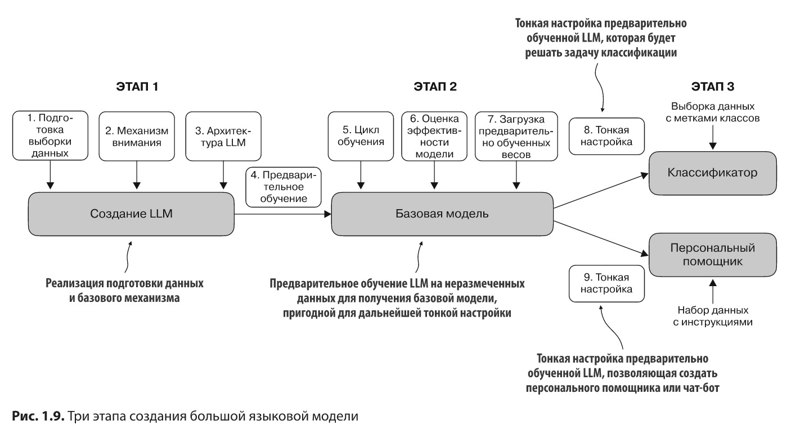

# [Книга][Рашка С.] Строим LLM с нуля [RUS, 2025]


**Оригинальные искодные коды:**  
https://github.com/rasbt/LLMs-from-scratch

<br/>

С первого раза не смог разобраться в должной мере. 
Мы тут "вроде как с 0" собираем. А по итогу, - выкачивааем из интернета уже готовое, т.к. сомостоятельно обучить, чтобы что-то хоть как-то работало, требуются вычислительные мощности стоимостью под $750k, да и то в случае успеха.

Придется вернуться попозже. Как появится желание упороться поглубже. Но похоже, идея которая и была изначально только подтвердилась, что в лучшем случае можно взять что-то готовое и сделать fine tuning.

Тут еще прошла инфа из 2х источников, что "Наш Гига Чат реально крут", это Qwen + наклейки. А яндекс, проводя свои обучающие семинары, тоже пользуется решениями от OpenAI. 


<br/>

## Оглавление:

<ol>
  <li>✅ Знакомство с большими языковыми моделями</li>
  <li>✅ Работа с текстовыми данными</li>
  <li>▶️⏸️ Программирование механизмов внимания</li>
  <li>▶️⏸️ Создание GPT-подобной модели для генерации текста с нуля (Соберем модель GPT-2 в коде)</li>
  <li>▶️⏸️ Предварительное обучение на неразмеченных данных (Предварительно обучим модель GPT-2)</li>
  <li>▶️⏸️ Тонкая настройка по классификации (Загрузим предварительно обученные веса из OpenAI)</li>
  <li>▶️⏸️ Тонкая настройка по инструкциям</li>
</ol>

<br/>



<br/>

### Python Environment Setup Video

<br/>

[](https://www.youtube.com/watch?v=yAcWnfsZhzo)

<br/>

```shell
$ mkdir -p ~/projects/dev/ml/llm
$ cd ~/projects/dev/ml/llm
$ git clone https://github.com/webmakaka/Build-a-Large-Language-Model-From-Scratch
$ cd Build-a-Large-Language-Model-From-Scratch/
```

<br/>

```shell
$ pip install uv
$ uv venv --python=python3.12
$ source .venv/bin/activate
$ uv pip install -r requirements.txt
$ uv run jupyter lab
```
